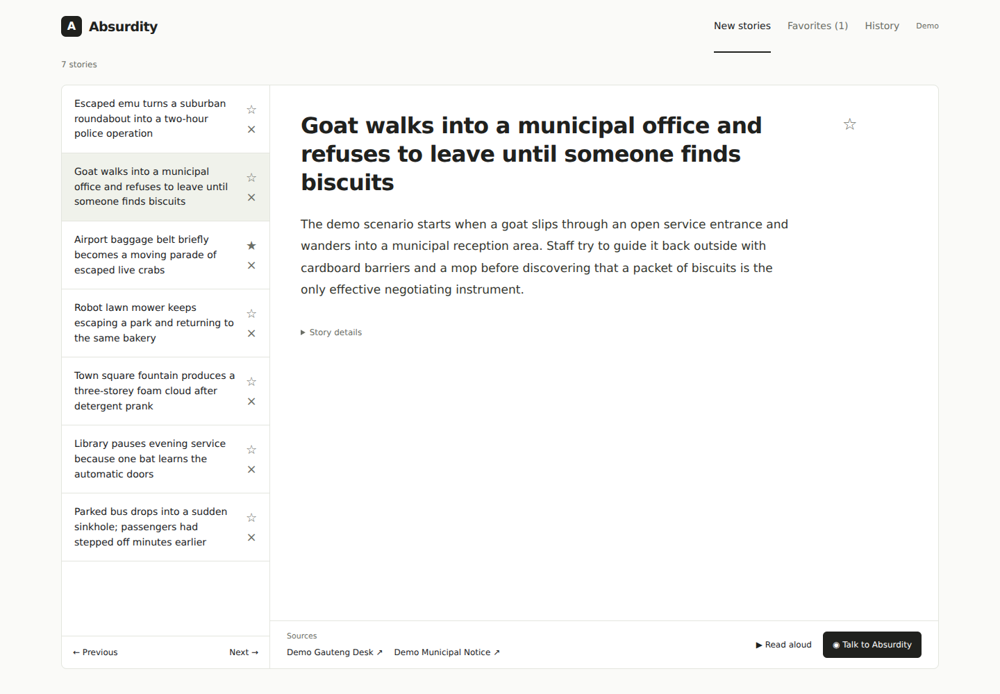
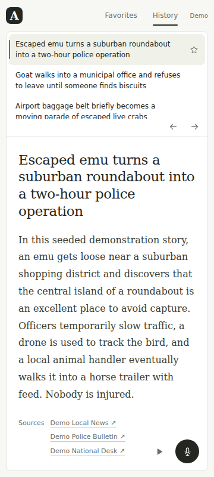
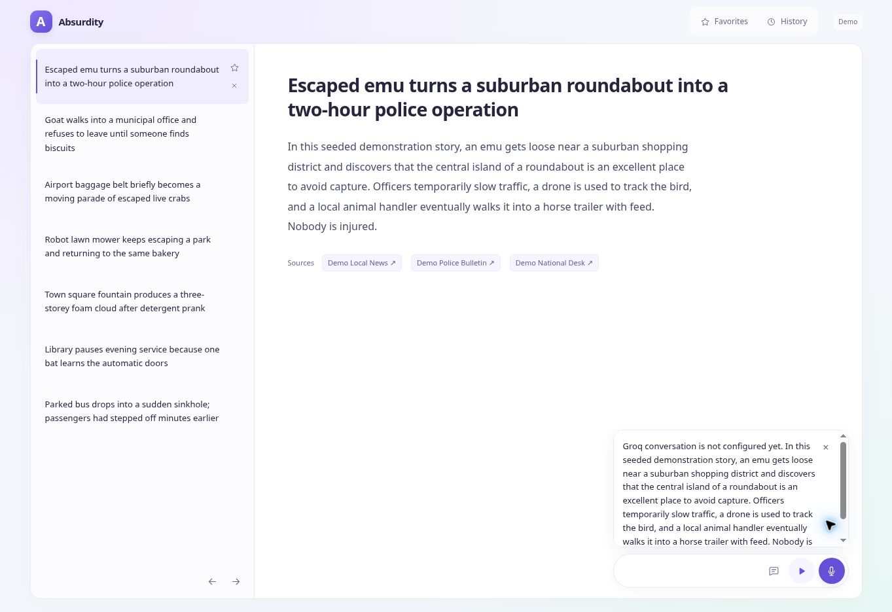
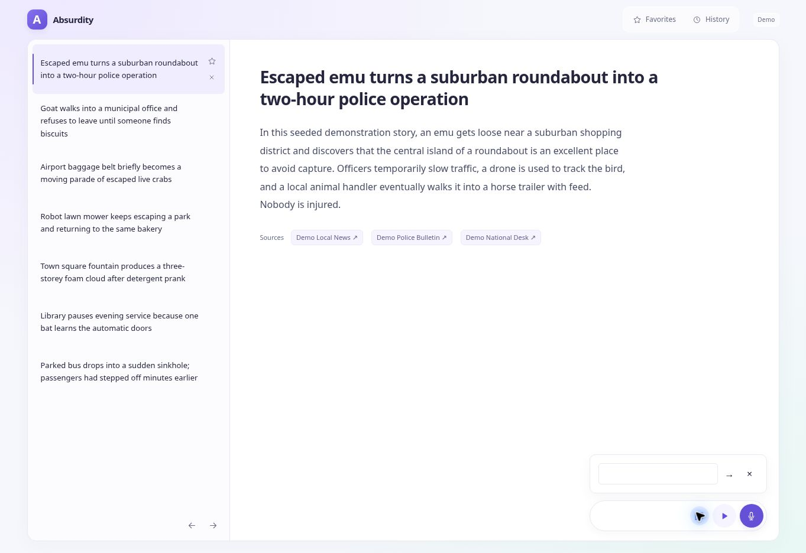
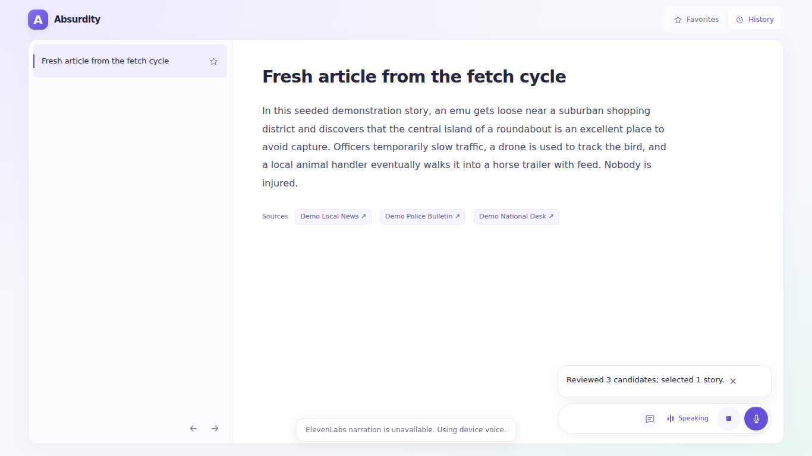
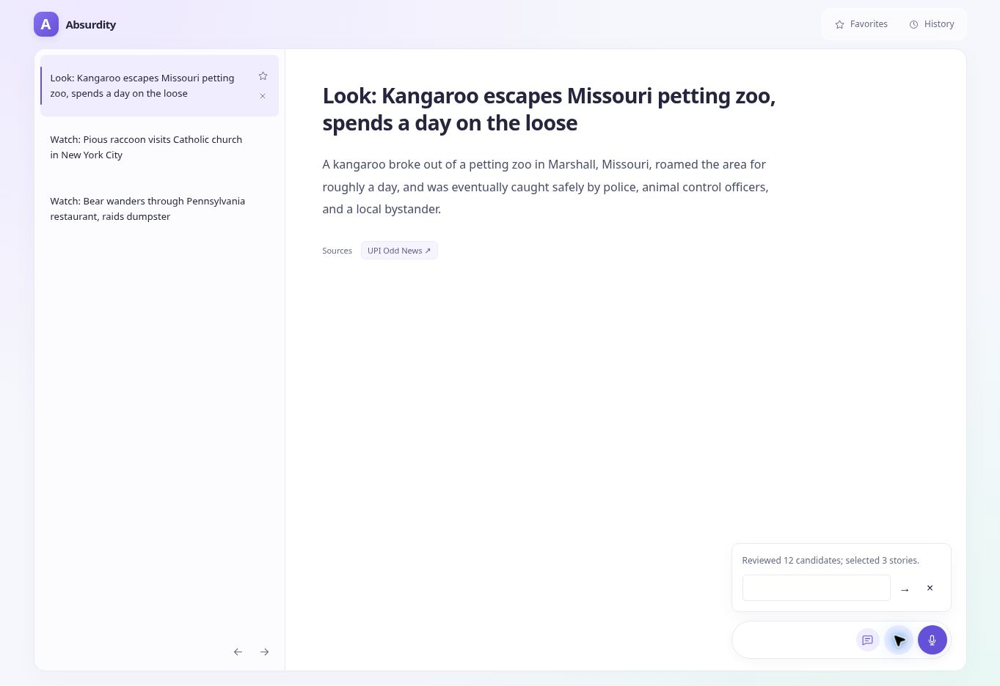

# QA: notebook reader and reliability fixes

## Microphone shutdown — 2026-10-12

- Explicit microphone shutdown now clears session ownership before calling recognition `abort()`, disables continuous capture and detaches result/error/end handlers. Stale result/end callbacks cannot act on the reader or restart listening, and a delayed native start from a stopped session is aborted again.
- Rapid clicks cannot create a second, orphan recognition session. Startup, restart and permission failures release the existing session; unmount uses the same cleanup. Stopping while a reply is pending remains stopped after narration ends.
- `stop recording`, polite variants of `stop listening`, and `turn off the microphone` are handled locally, without model or narration requests.
- Verified 91 automated tests, the production build and all seven browser suites. The dedicated microphone suite tracks each mocked session's capture/start/abort state and checks button/spoken shutdown, rapid clicks, stale callbacks, delayed start, replacement ownership, stop during a pending answer, no restart after playback, startup/abort failures, permission denial and manual restart. Audio and recognition are mocked; physical browser/device microphone behavior remains the user's live check. No ElevenLabs credits used.

## Referenced-story voice navigation — 2026-10-12

- Fixed the update-to-reading flow: daily, weekly and new-story requests search the saved archive, open the actual results and retain the IDs of the titles spoken in the reply. Daily means the previous 24 hours, weekly/new means the previous seven days, and today uses the Johannesburg calendar day. These requests do not launch discovery.
- Named story navigation resolves against the saved archive rather than the model's first 12 stories. Numbered selections retain absolute catalogue indices; `open the second one you mentioned` follows the spoken reply/page order. Ambiguous references ask for a choice and preserve the current article.
- Groq replies now include a validated `references` array of supplied story IDs. Subsequent turns retrieve these referenced stories even outside the visible list. Responses carry the referenced/selected saved articles, and the reader merges them before applying navigation, including Home/History transitions and restoration of explicitly selected dismissed stories.
- Fixed a phone interaction found during the same flow: narration/fetch status notices no longer intercept taps on the instruction form. The storage reload smoke check waits for persistence before reloading.
- Verified 91 automated regressions, TypeScript and the production build. All six browser suites passed. The new suite exercises the real chat route and demo repository for weekly/daily/new updates followed by referenced selection and narration, then checks 40-story title/number selection, spoken-page order, model references, an article delivered outside the initial archive, ambiguity and desktop/phone layouts with controlled API responses.
- Audio and recognition were stubbed for browser verification; no ElevenLabs credits or live research requests were used. The user will perform the live voice test.

## Mobile reader refinement — 2026-10-11

- Replaced the clipped single-row phone header with a compact brand row and full-width navigation. Home, Favorites, History and Refresh all fit at 320px; navigation and voice controls have 44px-high tap targets.
- The phone story list now opens from a Stories control with the current position and result count. Previous/next remain available while the list is closed. Choosing an article closes the picker and returns focus; Escape also closes it. The desktop sidebar remains visible.
- Increased phone body text to 16px, adjusted article spacing, bounded reply/input panels to the actual card width, and added safe-area spacing. The viewport requests content resizing for an onscreen keyboard; opening typing closes the picker, and opening the picker closes typing.
- Verified 84 automated tests and the production build, all five browser suites, and screenshots. The dedicated phone suite checks 320/360/393/414px widths, individual control bounds (not just document width), numbered selection beyond 12, favorites, dismissal/restore, picker focus, reduced-height keyboard typing, and restoration of the desktop layout. Keyboard coverage simulates the reduced viewport; physical keyboard behavior remains a device check.

## Follow-up QA — 2026-10-11 (Johannesburg)

- Fixed contradictory view/timeframe requests such as `find older stories from last week` and an old exact date in Home. They now explain the incompatible range rather than returning an action rejected by the reader. Queries above the supported 200-character archive limit also receive a useful reply.
- Explicit search and navigation no longer read and hydrate the whole briefing first. A failed unrelated briefing read cannot break those requests; grounded story conversation still retrieves its required evidence.
- Live `118b722f`: enumeration reported 60 stories, paging displayed numbers 9–16, and selection opened story 13 correctly. Last-week search returned 60 Home results and animal search returned 14. Eight consecutive warm follow-up searches across Home, History, Favorites, exact dates and empty results returned HTTP 200. The first database-backed search failed again after deployment of `eff09df`, so warm requests alone did not establish reliability.
- Render runtime logs at 23:01:34 and 23:29:01 UTC on 2026-10-10 recorded `DatabaseError: HTTP error! status: 404` in Turso's `describe` → `prepare` → `searchStories` path. The process retained an idle HTTP session baton; Turso expires idle streams. A regression using the installed driver and a protocol fixture backed by actual SQLite reproduced that exact 404/stack with the original implementation.
- The database wrapper now creates and closes a fresh Turso stream for each independent query, execution or batch, beginning at the configured database URL. Foreign keys are enabled on each stream before a transaction; atomic batches retain server-side commit/rollback and writes are never automatically retried. Direct `all`/`run` calls remove the unnecessary SQL metadata request. Cleanup failures preserve successful commits and original SQL errors.
- Verified **84 automated tests**, TypeScript, the production build and all four browser suites. New Turso regressions cover reads and writes after stream expiry, bound values including nulls and decimals, `INSERT ... RETURNING`, atomic rollback, foreign-key failures and cascading deletes, and cleanup failures. The edge-case browser suite checks the real chat route for conflicting dates and long queries, in addition to its controlled provider tests.

## Submission QA — 2026-10-10

- Fixed the enumeration/search blocker: explicit catalogue requests count the actual saved or visible results, list eight titles per page, and retain stable story numbers. `enumerate stories`, `list all stories`, `how many stories are available`, `next page`, and `open story 17` stay local and do not spend Groq quota. Search results receive the same numbered catalogue, so selection is not limited to the model's 12-story conversational context.
- Unscoped topic searches query the full saved archive. Recent matches open Home, older-only matches open History, and mixed results report both buckets. Exact recent dates and “last week” requests no longer create an impossible History interval. Explicit History and Favorites scopes retain their existing meanings; Home/History remain mutually exclusive.
- Added local unfavorite commands, typed-input focus, bounded multiline replies, an honest empty-search message, and reader/selected-row scroll handling. Passive archive sync preserves the selected History article.
- Bounded archive, chat, narration, research start and status requests through body consumption, with cancellation support that does not require modern AbortSignal helper APIs in the browser. Stopping narration aborts its request; disappearing articles stop their old speech or pending answer. Recognition pauses while thinking as well as while speaking. Simultaneous playback errors trigger device fallback only once.
- Reject corrupt archive/conversation payloads safely, restrict reader links to HTTP(S), and reject malformed/opaque research origins. Oversized narration falls back to the full device reading rather than silently truncating at 5,000 characters.
- Verified **78 automated tests**, TypeScript and a production build. All four browser suites passed: reader smoke, research, archive reliability, and the new 40-story edge-case suite. Checks include a 20-result search with numbered selection beyond result 12, aborted narration, duplicate media errors, favorite removal during playback, preserved History selection, corrupt rows, microphone echo suppression during thinking, and mobile reply bounds. Browser provider/audio behavior is stubbed for reproducibility.
- Live baseline: deployed `f283bc2a` returned a healthy Turso diagnostic, 60 saved stories, an HTTP 200 Groq-grounded story answer, and HTTP 200 playable MPEG audio from ElevenLabs. That proves provider output, not audible playback or real microphone recognition on the recording device.

Run the additional browser suite with `node tests/browser-edge-cases.mjs` against the isolated demo server described below. Production credentials are not needed for the automated browser suites.

## Latest reliability pass — 2026-10-07

- Fixed repeat processing of selected stories: canonical URLs and recent event clusters are checked before paid provider work and the candidate cap. Unselected candidates remain eligible; unrelated later events may reuse a headline.
- Applied the date window before publisher caps and preserved Exa priority in the final shortlist.
- Prevented two publisher labels on the same domain from counting as independent discovery sources in deterministic fallback.
- Allowed database initialization to retry after a failed connection/setup attempt, and aligned default health mode with the live reader.
- Added archive loading/error states, bounded archive requests, explicit retry, cached-story retention on failure, and strict explicit-demo handling for malformed responses.
- Updated browser checks and README for separate Home and Refresh controls and honest empty live archives.
- Added constant-query archive hydration: History now loads story rows, sources and research steps in three database queries instead of two child queries per story; the regression suite asserts the query count stays constant as the archive grows.
- Restored the compact publication-date/verification footer and enabled daily scheduled research by default, with `ENABLE_DAILY_RESEARCH=false` retained as a quota kill switch.
- Added final lifecycle/security hardening: 7-day Home/History semantics are shared across navigation and Groq planning, production voice mode is server-authoritative so clients cannot force demo fixtures, remote source links are restricted to HTTP/HTTPS, and the Turso driver is pinned for reproducible installs.
- Verified: **63 automated tests**, TypeScript and the production build. Browser provider/voice responses are stubbed; database regressions use isolated SQLite. Production Turso/provider credentials remain runtime checks.

## Product layout

The October notebook defines a simple interface: Home, Favorites and History; a scrollable title list beside a scrollable story; source links after the article; and a speak button for navigation. Home contains stories from the last 7 days; once a story crosses that cutoff it appears only in History. The two age buckets are mutually exclusive.

The reader now follows that layout. Per-story category badges, ranked metadata, repeated instructions, large verification cards and the promotional subtitle have been removed from the default view. Only the article title is a visible heading. Source links follow the article inside the scrolling reading pane, followed by one quiet footer containing the publication date and verification confidence; the full verification note stays available as a tooltip rather than another card. Small read/talk controls stay at the bottom-right. Manual search/date fields, story counts and repeated favorite controls have been removed. Requested navigation instructions search stored stories; they never invoke discovery. The chatbox has no visible command list, placeholder or explanatory text; it shows only the input, controls and an actual reply. A compact typed instruction box opens from the chat control or when speech recognition is unavailable or microphone access is denied. On phones the title list sits above the reading pane within the viewport. The visual system is monochrome black/white/grey, with red reserved for the black question-mark brand tile. A small floating dock shows listening, thinking, preparing and speaking states, with reserved space so it cannot cover the article, sources or footer. Styling adds no fonts or dependencies; conversation requests run only after user instructions.

## Verified

- Production build and TypeScript.
- 63 automated regressions: archive/search with combined criteria and date bounds, navigation parsing, Johannesburg publication days, API validation, demo grounding, narration fallback, healthy and degraded database readiness, empty-database initialization, required-Turso startup protection, atomic story/source/research rollback, SQLite story/source/research persistence, 7-day Home/History partitioning and future-date filtering, permanent selected history, research-run telemetry, Groq response validation and provider failures, structured conversation plans, article/history context, rejection of invented actions/IDs, exclusion of reasoning text, actual archive result counts and safe live fallback.
- Browser checks at 1366×768, 1280×720, 360×640, 360×800 and 844×390 in Africa/Johannesburg: repeated voice next commands, favorite/favorites distinction, favorite and dismissal reload persistence, requested geography/category/older/favorites search, typed navigation after microphone denial, dismiss/restore, source links, browser speech fallback, cancellation during narration preparation, conversational context, microphone pause/resume, echo suppression and cancellation of pending conversation actions.
- No page errors, page-level scrolling or horizontal overflow in those browser checks.

Speech recognition and synthesis are stubbed for repeatable control tests, so real microphone recognition and audible playback still require device testing. Live Render/Turso startup and deployment behavior was rechecked on 2026-10-07 after the final hardening pass. The current deployment now requires Turso explicitly, performs a database readiness check before startup and before scheduled research, creates schema on an empty database, and uses atomic batches for story/source/research updates. Hosted provider credentials and audible ElevenLabs playback are external runtime checks rather than claims made by CI.

## Run checks

```bash
npm ci
npm test
npm run typecheck
npm run build
npm start
```

For the optional browser regression script, install Playwright locally without changing application dependencies:

```bash
npm install --no-save --package-lock=false playwright
npx playwright install chromium
node tests/browser-smoke.mjs
node tests/browser-research.mjs
node tests/browser-reliability.mjs
```

Run against a separate demo database and demo server. The script changes only its fresh browser profile. Set `QA_BASE_URL` for a different server, `QA_CHROMIUM_PATH` for an existing Chromium executable, and optionally `QA_SCREENSHOT_DIR` to capture screenshots.

## Hosting region

`region: frankfurt` selects where the Render backend runs. It does not restrict the public site's visitors to Europe. This configuration runs one regional backend, rather than replicated compute in multiple regions.

## Reader previews







The deployed empty chatbox was verified after the descriptor cleanup; actual replies remain visible.



Full article ingestion checks cover paragraph/tail retention, publisher character encoding, removal of scripts and page chrome, restricted-page fallback, unsafe hosts and redirects, byte/type/deadline limits, native socket address pinning, full-body persistence, preservation after weaker rechecks, bounded model text and the complete discovery → extraction → analysis → storage path. A real ABC source retrieval was attempted here but DNS returned `EAI_AGAIN`; production publisher retrieval is not claimed as verified by this workspace check.

## Refresh fetch cycle

Only the explicit **Refresh** control (or an explicit refresh instruction) starts the discovery/extraction/analysis/persistence pipeline. The black/red question-mark logo and Home are navigation only. Unit checks cover concurrent manual claims, overlap prevention with the daily job, completion and shared cooldown, failed-feed discovery, stale-run recovery, lease ownership, cross-site rejection and joining an active cycle. Browser checks with deterministic API responses verify Home does not spend research quota, repeated Refresh clicks share one run, loading state, refreshed story content, terminal/start failure handling, reload resume without another POST, and the single-page layout.

Scheduled research is enabled by default at 03:17 UTC (05:17 Johannesburg); `ENABLE_DAILY_RESEARCH=false` is the explicit kill switch. GitHub Actions triggers the production Render `/api/research` endpoint and polls that run instead of duplicating Turso/provider secrets into GitHub. The page itself does not continuously run discovery: it passively checks the saved Turso archive every five minutes while visible and on focus. Explicit web-process fetches can still be interrupted by a deployment/restart. Live publisher/provider calls remain separate from mocked browser verification.

## Refresh-command and narration regressions (2026-10-06)

The deployed pre-fix reader displayed one BBC story. Asking "Refresh the stories" claimed that stories had been refreshed, without a research action. Refresh is now a deterministic, explicit action shared with the icon, and never becomes a stored-archive search. The browser regression verifies that the current History article remains visible during a typed fetch and after an empty archive response. Completion reports reviewed candidates and selected stories separately.

Discovery no longer truncates candidates before date filtering and event clustering. UPI Odd News and Guardian World widen the source pool. A complete fixture regression presents 20 stale high-score headlines, one future headline and three recent odd-news stories; all three recent stories are extracted, analysed, stored, selected and returned in the current briefing. RSS publication timestamps are stored as ISO dates. Results still depend on sources and editorial acceptance; a fixed number of live stories is not guaranteed.

ElevenLabs now returns actionable, sanitised errors for a missing voice ID, key/permission failures, quota limits, voice access and invalid audio. Environment values are trimmed. Successful audio, missing voice configuration and provider-error redaction are tested. The browser shows the reason when it falls back to device speech; it does not silently imply ElevenLabs worked. Production credentials and audible playback are not claimed as verified by the mocked regression.



## Live refresh and narration check (2026-10-06)

After deployment of `aeec039`, the typed instruction “Refresh the stories” ran the real research pipeline, reviewed 12 candidates and selected three UPI stories. The reader showed the kangaroo, raccoon and bear articles with publisher links. The live narration request in this historical check reached ElevenLabs and was rejected with HTTP 402. The deployment configuration was subsequently corrected. Device speech remains the fallback, and audible ElevenLabs playback is still treated as a runtime check rather than something CI can prove.

Error handling accepts the current `detail.code` field and legacy `detail.status`, with an actionable HTTP 402 fallback. No raw provider message or credential is exposed.




## Exa-first discovery (2026-10-06)

When `EXA_API_KEY` is configured, Exa is the primary discovery layer. Each cycle runs freshness-bounded news searches across eight editorial lenses, keeps publication dates and source URLs, limits repeated domains before clustering, and then adds RSS candidates as secondary/fallback coverage. Exa discovery results are never promoted directly: article extraction, independent corroboration, Groq verification/classification and the existing promotion rules still apply.

Corroboration searches exclude the discovered article's domain when Exa supports that filter, encouraging independent reporting. Provider telemetry records whether discovery ran as `exa+rss` or RSS-only and how many Exa discovery queries were attempted. Regression coverage verifies the freshness bounds, news category, domain diversity, RSS fallback and Exa request options.
